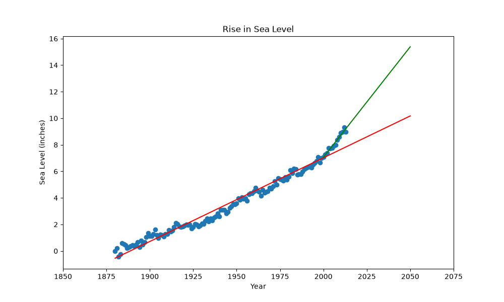

# Sea Level Predictor

Solusi proyek freeCodeCamp *Data Analysis with Python* — Sea Level Predictor.

## Deskripsi

Proyek ini menganalisis dataset perubahan permukaan air laut global rata-rata dari tahun 1880 hingga 2014. Data dianalisis menggunakan **Pandas**, **Matplotlib**, dan **Scipy** untuk memprediksi kenaikan permukaan air laut pada tahun 2050 menggunakan regresi linear.

## Fitur & Tugas

1. **Scatter Plot:** Memvisualisasikan data mentah (tahun vs ketinggian air laut).
2. **Regresi Linear 1 (Semua Data):** Membuat garis tren dari tahun 1880 hingga 2050 menggunakan `scipy.stats.linregress`.
3. **Regresi Linear 2 (Data 2000 ke atas):** Membuat garis tren terpisah khusus untuk data tahun 2000 ke atas, untuk melihat apakah laju kenaikan air laut saat ini lebih cepat dibandingkan abad sebelumnya.

## Hasil Visualisasi



*Keterangan: Garis merah adalah tren dari seluruh data (1880+). Garis hijau adalah tren dari data tahun 2000 ke atas, yang memprediksi kenaikan air laut lebih tinggi di tahun 2050.*

## Struktur Project

| File | Keterangan |
|------|-----------|
| `sea_level_predictor.py` | Kode utama untuk analisis regresi dan plot |
| `main.py` | Entry point untuk menjalankan unit test |
| `test_module.py` | Unit test dari freeCodeCamp |
| `epa-sea-level.csv` | Dataset perubahan permukaan air laut |
| `requirements.txt` | Dependensi (`pandas`, `matplotlib`, `scipy`) |

## Cara Menjalankan

```bash
# Install dependensi
pip install -r requirements.txt

# Jalankan program
python main.py
```

## Hasil Test

```text
Ran 4 tests in 1.603s

OK
```
